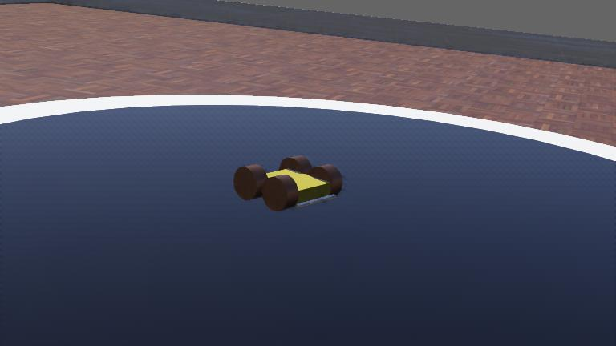

# Pololu Sumo Robot (Webots)

> University team project, 2023.

<!-- DEMO VIDEO: pending from owner -->



A simulated Pololu Zumo-style sumo robot in [Webots](https://cyberbotics.com/): a four-wheel chassis with distance and infra-red sensors, a circular dojo, and a reactive C++ controller.

## Why it is interesting

It is a compact, complete sense-act loop on a simulated mobile robot: the team modelled the robot, its motors and sensors in a Webots world by hand, then wrote the controller against the Webots C++ API. The commit history shows the robot evolving step by step (sensors, wheel motors, sensor placement).

## Stack

- Webots R2023a (world and project files)
- C++ with the Webots controller API

## How it works

```
worlds/Zumo.wbt                              Pololo_Controller.cpp (64 ms loop)
 Robot                                        read 3 distance + 3 IR sensors
  ├─ DistanceSensors: front_ds, left_ds,      ├─ nothing detected → drive forward
  │  right_ds                       ───────►  ├─ threshold crossed → set flag
  ├─ IR sensors: IR_1, IR_2, IR_4             │    and spin in place
  └─ Motors: MOTOR_{FRONT,BACK}_{LEFT,RIGHT}  └─ flags clear on a later reading
 Dojo: cylinder, radius 0.66 m (0.56 m black inner circle), on a 5 x 5 m arena
```

The controller is a flag-based reactive state machine:

- It drives all four motors at half of `MAX_SPEED` while no flag is set.
- A front reading below 901, or a side reading below 700, sets a flag.
- While a flag is set, the left and right motor pairs turn in opposite directions at a quarter of `MAX_SPEED`; the direction depends on which sensor fired.
- The front and right flags clear when the right sensor reads below 1000; the left flag clears when the left sensor does. Using the right sensor for the front flag looks like a copy-paste quirk.

### Current limits

- `Zumo.wbt` contains one robot, despite the repository name. There is no multi-robot code here.
- The IR sensors are enabled and read, but no decision uses them yet, so edge detection is not implemented. A comment records calibration values for the dojo surfaces (black 439, white 88).

## Results

The repository holds no recorded results, match data or metrics.

## How to run

These steps come from the files in the repository; they were not re-run for this publication.

1. Install Webots R2023a. The world loads its standard PROTOs from GitHub, so the first open needs internet access.
2. Build the controller, since compiled binaries are not tracked. Either open `controllers/Pololo_Controller/Pololo_Controller.cpp` in the Webots editor and press Build, or run:
   ```
   export WEBOTS_HOME=/path/to/webots
   make -C controllers/Pololo_Controller
   ```
3. Open `worlds/Zumo.wbt` in Webots and start the simulation. Sensor readings print to the Webots console.

## Repository layout

```
controllers/Pololo_Controller/   Controller source and the Webots Makefile
worlds/Zumo.wbt                  Simulation world: robot, dojo, arena
worlds/.Zumo.wbproj, .Zumo.jpg   Webots project state and world preview
```

## Team and credits

Commit authors: [alejandrorubioo](https://github.com/alejandrorubioo), [CarlosD31](https://github.com/CarlosD31), [Luperbal](https://github.com/Luperbal), Pablo Martínez Juan.

Team project; I worked across the whole implementation.

`controllers/Pololo_Controller/Makefile` is the Webots template and keeps its Cyberbotics copyright and Apache 2.0 notice.

All rights remain with the authors; a licence is pending.
